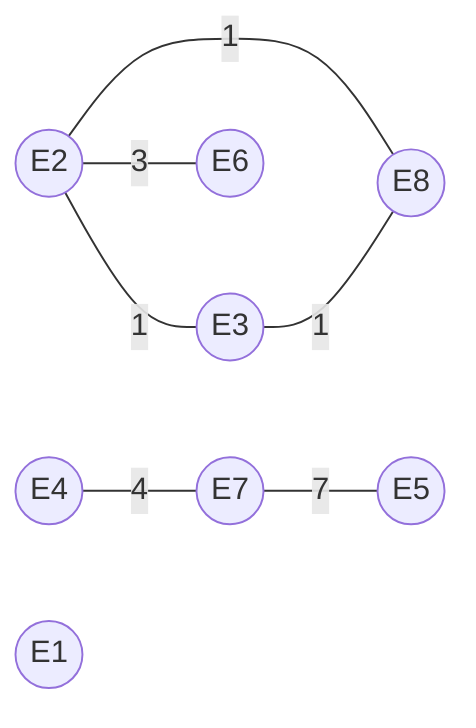

# Learning Languages

J'ai résolu le problème "Learning languages" provenant du "CodeForces Round 170 (div 1)". 

Après une brève présentation du problème, je présente ma solution, le paradigme sous-jacent ainsi que les faiblesses et les forces de celui-ci.

Les détails sur la lecture des données sont mises de coté dans le but de se concentrer sur l'essentiel de l'algorithme.

Le problème résolue se trouve sur CodeForces (https://codeforces.com/problemset/problem/277/A).


# Formulation du problème
J'ai une équipe de $n$ employé où tout le monde parle un certain nombre de langue. J'aimerais faire en sorte que tous les membres puissent communiquer entre eux. 

Pour se faire, je décide de payer des cours de langue aux employées dans le besoin. Chaque cours coûte une unité d'argent.

La question est de savoir combien cela va me couter de pouvoir faire communiquer toute le monde en sachant que  j'accepte qu'un employée puisse faire l'intermédiaire entre deux employée ne parlant pas la même langue.


# Paradigme

Je modèlise ce problème à l'aide d'un graphe où les noeuds représentent chaque employée. Deux employées qui parlent une même langue sont reliés par les arètes comme représenté sur le graphe ci-dessous.




Ce graphe correspond à l'exemple de l'énoncé (8 employés, 7 langues), dont la réponse attendue est 2. L'étiquette de chaque arête indique la langue partagée. On remarque le triangle $E_2, E_3, E_8$ : compter les paires d'employés qui partagent une langue reviendrait à compter des liens redondants. C'est pourquoi il faut raisonner en composantes connexes plutôt qu'en nombre d'arêtes.

Ainsi, la question peut être reformulée de la sorte : combien d'arêtes faut-il ajouter au minimum pour rendre le graphe connexe ? Pour rappel, un graphe connexe est un graphe où il existe un chemin entre toute paire de nœuds.

Le problème revient donc à **compter les composantes connexes** du graphe. Pour cela, j'utilise la structure de données **Union-Find** (aussi appelée *Disjoint Set Union*, DSU), qui maintient une partition des nœuds en ensembles disjoints. Un parcours en largeur (BFS) ou en profondeur (DFS) permettrait d'obtenir le même résultat.

Pourquoi ? 

Comme on le visualise sur le graphe ci-dessus, chaque employée ayant une langue en commun sont regroupé dans un même ensemble. 

En comptant le nombre d'ensemble, je peux aisement définir le nombre d'arètes que j'ai besoin pour connecter le graphe.

Formellement, si j'ai $c$ ensemble qu'on nomme composante, le nombre de lien à ajouter correspond à $c-1$.

En admettant que le cout d'un arete vaut une unité d'argent, le cout minimal est donc directement calculé.

### Justification de $c - 1$ *(à compléter)*

**Borne inférieure.** # À compléter : montrer qu'il faut au moins c − 1 cours (combien de composantes un seul cours peut-il fusionner au maximum ?).

**Atteignabilité.** # À compléter : donner une stratégie qui connecte le graphe avec exactement c − 1 cours.

**Lien avec le cas limite.** # À compléter : expliquer pourquoi l'argument ne s'applique plus quand personne ne parle de langue, et pourquoi le coût devient n.


# Algorithme

Au niveau de l'algorithme, cela correspond à un Union-Find classique, seulement la présentation des données est différente.

En effet, l'entrée correspond aux langues parlées par chaque employée. Chaque langue est identifiée par un entier $a_i \in \{1, \dots, m\}$, où $m$ est le nombre de langues.

Pour rassembler deux employée dans un même ensemble, je vérifie le prédicat suivant : deux employées parlent une même langue si et seulement si l'intersection des deux ensembles de langues parlées par chaque employée est non vide, c'est-à-dire $L_i \cap L_j \neq \emptyset$, où $L_i$ désigne l'ensemble des langues parlées par l'employé $i$.

Si la proposition est vérifiée, j'opère l'union entre les deux noeuds, suivant la logique définie par l'algorithme Union-Find. 

Pour améliorer les performances, je rattache toujours l'arbre le plus petit sous l'arbre le plus grand (*union par taille*). Cette règle garantit que la hauteur de chaque arbre reste au plus $\log_2 n$ : la profondeur d'un nœud n'augmente que lorsque son arbre est rattaché sous un arbre au moins aussi grand, donc la taille de son arbre au moins double à chaque fois, ce qui ne peut arriver que $\log_2 n$ fois. Un `find()` coûte alors $O(\log n)$ dans le pire cas. Combinée à la compression de chemin, la complexité amortie par opération devient $O(\alpha(n))$, où $\alpha$ est l'inverse de la fonction d'Ackermann (voir Cormen, Leiserson, Rivest, Stein, *Introduction to Algorithms* (CLRS), chapitre « Data Structures for Disjoint Sets » : chapitre 21 dans la 3ᵉ édition, chapitre 19 dans la 4ᵉ).


Après avoir défini $c$ la cardinalité de l'ensemble des racines uniques présentes dans la liste "parents", le nombre de lien manquant est égalé à $c-1$. Cependant, cela n'est pas la bonne manière d'opérer ce calcul. J'en parle dans la dernière partie de cette note.


Le seul cas limite que la boucle principale ne prend pas en compte est que si aucun n'employée ne parle de langue, il faut considérer que je dois payer un cours à chaque employé. Le cout total s'évalue alors au nombre d'employée $n$.

Je considère que la cas est équivalent à dire que la somme des tailles des ensembles de langues parlées par chaque employée est égale à zéro.


# Limites

La première limite critique est la définition de $c$.
```python

print(len(set(parents)) -1)

```


## Limites 1 : mauvaise définition du nombre de composante

Le code ci-dessus ne compte pas les composantes dans toutes les situations.
Pour que ce code fonctionne de manière systématique, il faut faire l'hypothèse que tous les chemins de tous les noeuds ont été compréssés. 

En effet, quand une racine qui a déjà des enfants est rattachée sous une autre racine, ses enfants pointent toujours vers l'ancienne racine tant qu'aucun `find()` ne repasse par eux. L'ancienne racine apparaît alors dans `parents` et est comptée comme une composante supplémentaire.

Contre-exemple (réponse attendue : 0) :

```
4 6
2 1 5
2 2 3
2 2 6
2 1 3
```

Déroulé (employés indexés de 0 à 3) :

1. La paire (0, 3) partage la langue 1 : 3 est rattaché à 0.
2. La paire (1, 2) partage la langue 2 : 2 est rattaché à 1.
3. La paire (1, 3) partage la langue 3. Les deux arbres ont la même taille, donc la racine 0 est rattachée sous 1.
4. La paire (2, 3) ne partage aucune langue : aucun `find(3)` n'est appelé, et le chemin de 3 n'est jamais compressé.

À la fin, `parents = [1, 1, 1, 0]`, donc `set(parents) = {0, 1}` et le code affiche 1 au lieu de 0.

La bonne manière de procéder est la suivante :

```python

print(len({find(i) for i in range(n)}) - 1)

```

Je génére la liste des racines en retournant sur tous les noeuds sa racine propre au moyen de la fonction `find()`.


## Limites 2 : boucle non-optimisé

La double boucle d'attribution des employées au différents ensembles a un complexité en $O(n^2*k)$. Cela peut être optimisé en reformulant le problème.

Dans notre situation, le nombre d'employée $n$ est bornée supérieurement à 100, ce qui nous autorise à garder cette double boucle.

Pour optimiser l'algorithme, il suffit de considèrer les langues comme des noeuds. Chaque employée est donc juste assigné à la langue à laquelle il parle.
L'algorithme effectue alors une union par couple (employé, langue parlée), soit $\sum_i k_i$ unions sur $n + m$ nœuds, où $k_i$ est le nombre de langues parlées par l'employé $i$. La complexité devient $O\big((n + m + \sum_i k_i)\,\alpha(n + m)\big)$, c'est-à-dire quasi linéaire en la taille de l'entrée.